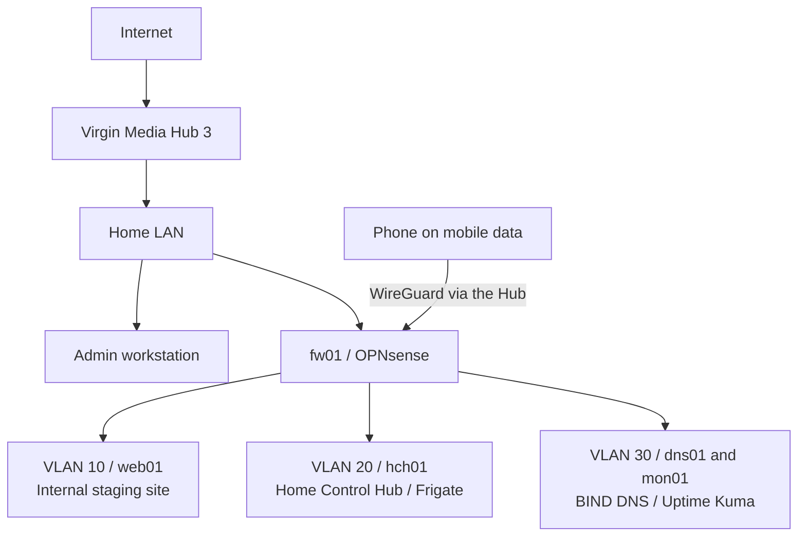
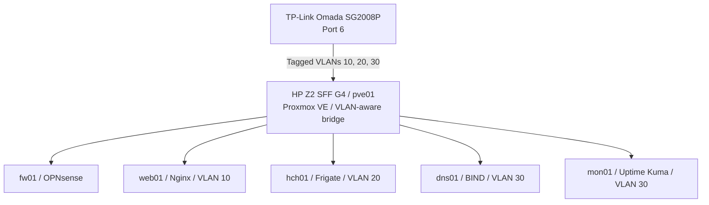

# Current lab network topology

The HP Z2 SFF G4 (`pve01`) runs Proxmox VE and hosts the lab VMs. The OPNsense VM, `fw01`, routes traffic between the home LAN and lab VLANs. The public portfolio runs on GitHub Pages; `web01` is the internal staging site used to review website updates.

## Network layout

`fw01` provides the lab VLAN gateways, DHCP, and firewall rules. Traffic between VLANs passes through `fw01`; devices on the same VLAN can communicate directly. The admin workstation reaches permitted lab services through routes and scoped firewall rules.

The phone's WireGuard tunnel terminates on `fw01`. A scoped VPN rule allows access to Frigate on `hch01` in VLAN 20. Frigate is not exposed directly to the internet.

## Proxmox and switch

Port 6 carries the tagged lab VLANs between the Omada switch and Proxmox. VM traffic can stay inside the Proxmox host; `fw01` handles routing and firewall policy when traffic crosses VLANs.

## Key paths

| Source | Destination | Path |
| --- | --- | --- |
| Admin workstation | Permitted lab services | Home LAN → `fw01` → target VLAN |
| Phone on mobile data | Frigate on `hch01` | WireGuard via Virgin Media Hub → `fw01` → VLAN 20 |
| VLAN clients | Internal DNS on `dns01` | Client VLAN → `fw01` → VLAN 30 |
| VLAN clients | Internet | Client VLAN → `fw01` → Home LAN → Virgin Media Hub |

## Network roles

| Network | Current role |
| --- | --- |
| Home LAN | Admin workstation and upstream network for `fw01` |
| VLAN 10 | `web01`: internal portfolio staging site |
| VLAN 20 | `hch01`: Home Control Hub and Frigate |
| VLAN 30 | `dns01`: BIND DNS; `mon01`: Uptime Kuma |

This document omits IP addresses, VPN configuration, management endpoints, device identifiers, and camera connection details.
