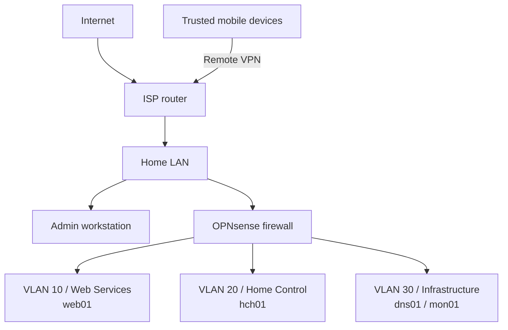
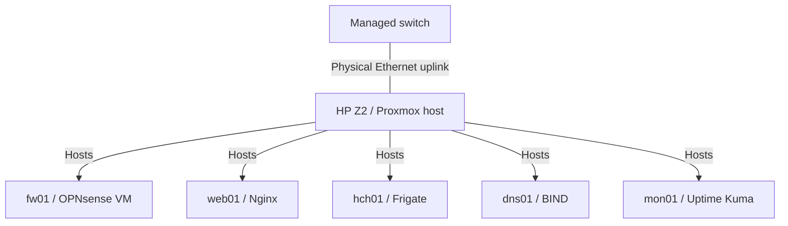

# Current lab network topology

The lab is easiest to understand in two views: the network boundaries and the virtual machines hosted by Proxmox. Addresses and connection details are intentionally omitted here.

## Network boundaries

OPNsense provides the gateway and firewall policy for routed access between the home LAN and lab VLANs, between lab VLANs, and from remote VPN clients. It also provides DHCP for the lab VLANs and terminates remote VPN access. Devices in the same VLAN can communicate directly without passing through OPNsense.

## Proxmox hosting

The HP Z2 runs Proxmox and hosts fw01, web01, hch01, dns01, and mon01. The arrows labelled Hosts show where the VMs run, not packet paths. Proxmox provides virtual VLAN connectivity, while OPNsense provides routing and firewall policy between networks.

The physical switch connects external wired devices and the home LAN to the host. Lab VLAN tags were configured on the Z2 switch port, but that configuration only applies to frames crossing the physical uplink. Traffic between VMs and fw01 can remain inside Proxmox, including inter-VLAN traffic routed by fw01. Matching VLAN entries on Omada are not required for traffic that stays within the host.

## Important paths

| Source | Destination | Path |
| --- | --- | --- |
| Admin workstation | SSH and browser-based administration of permitted systems and services | Home LAN → OPNsense → target VLAN |
| Trusted mobile devices | Permitted internal services | ISP router → remote VPN terminated by OPNsense → target VLAN |
| `web01` and `hch01` | `dns01` | Source VLAN → OPNsense → VLAN 30 |
| VLAN clients | Internet | Source VLAN → OPNsense → home LAN → ISP router |

## Network roles

| Network | Current role |
| --- | --- |
| Home LAN | Admin workstation and upstream network for OPNsense |
| VLAN 10 | Internal portfolio deployment and review copy: `web01` and Nginx |
| VLAN 20 | Home-control services: `hch01` and Frigate |
| VLAN 30 | Infrastructure services: `dns01` with BIND and `mon01` with Uptime Kuma |

The public portfolio is served from GitHub Pages; `web01` is the internal deployment target, not the public web host. This topology document omits addresses, public-facing connection details, VPN configuration, management endpoints, device identifiers and camera connection details. Individual project records may retain private RFC1918 addresses when they explain a historical build or troubleshooting step.
