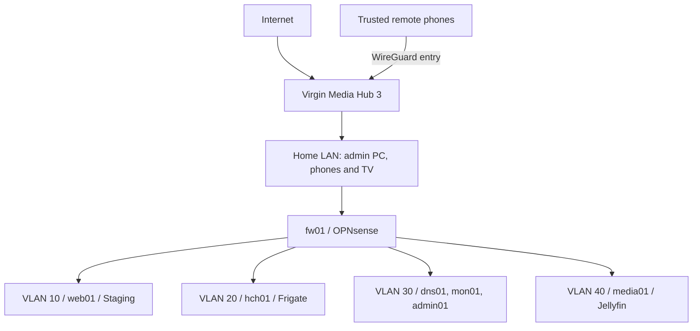

# Current lab network topology

The always-on HP Z2 SFF G4 (`pve01`) runs Proxmox VE and hosts the lab VMs. OPNsense (`fw01`) routes between the home network and lab VLANs. GitHub Pages serves the public portfolio; `web01` is the internal staging site.

## Logical layout

`fw01` provides VLAN gateways, DHCP, firewall policy and outbound NAT. The WireGuard tunnel terminates on `fw01`; its existing scoped access is for Frigate in VLAN 20. Remote Jellyfin access is not documented as tested.

## Networks and services

| Network | Current role |
| --- | --- |
| Home LAN | Admin workstation, phones, TV/casting devices and upstream network for OPNsense |
| VLAN 10 | `web01`: internal Nginx portfolio staging site |
| VLAN 20 | `hch01`: Home Control Hub / Frigate |
| VLAN 30 | `dns01`: BIND; `mon01`: Uptime Kuma; `admin01`: Ansible administration |
| VLAN 40 | `media01`: Debian 13, Docker Compose and Jellyfin; /28 subnet |

`admin01` can be powered on for automation practice. The disposable Ansible web test VM is not a permanent service in this topology.

## Access paths

| Source | Destination | Working path |
| --- | --- | --- |
| Admin PC | Permitted lab services | Windows route → OPNsense → target VLAN, with scoped rules |
| Home phone | Jellyfin | OPNsense home-facing WAN address, TCP 8096 → destination NAT and associated rule → media01 TCP 8096 |
| TV / casting device | Jellyfin playback | Phone app casting confirmed; media access must be permitted through the lab boundary |
| Remote phone | Frigate | Virgin Hub WireGuard UDP forwarding → OPNsense VPN termination → scoped VLAN 20 access |
| VLAN clients | BIND DNS | Source VLAN → OPNsense DNS rule → dns01; external lookups also require BIND recursion permission |
| VLAN clients | Internet | Source VLAN → OPNsense filtering / outbound NAT → Virgin Hub |
| admin01 | Managed Debian target | SSH and Ansible privilege escalation through permitted firewall paths |

Jellyfin’s forwarding rule is on OPNsense for home-network clients. No Jellyfin internet port forward was added on the Virgin Hub. The initial source restriction was the phone; successful casting was reported, but the final casting-device source rules still need a configuration audit. A full negative isolation test for VLAN 40 is pending.

## Host, switch and storage

Omada switch port 6 carries tagged VLANs 10, 20, 30 and 40 to the Z2’s VLAN-aware Proxmox bridge. Traffic between VMs may remain within the host; OPNsense handles routing and policy when crossing VLAN boundaries.

| Storage | Use |
| --- | --- |
| SSD | Proxmox and VM operating systems; Jellyfin configuration/cache inside media01 |
| HDD partition 1 | Existing Proxmox backup storage |
| HDD partition 2 | ext4 hdd-media storage containing media01’s separate 400 GiB virtual disk |
| Inside media01 | ext4 media disk mounted at /srv/media; movies, shows and podcasts |

Jellyfin sees the media through a read-only container mount. Two partitions on the same HDD do not provide disk-failure redundancy. Media backups, a media.internal record, Jellyfin monitoring and controlled reboot recovery checks remain follow-up work.

Public diagrams omit live IP addresses, management endpoints, device identifiers, VPN secrets and camera connection details.
